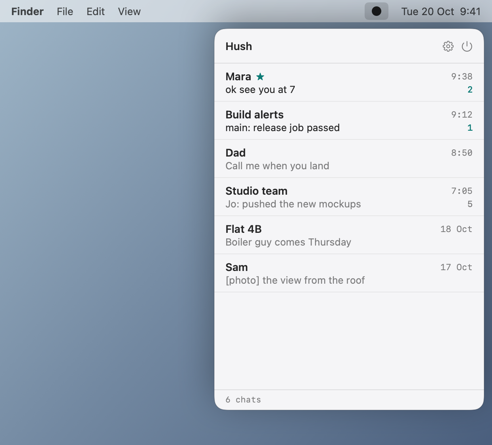
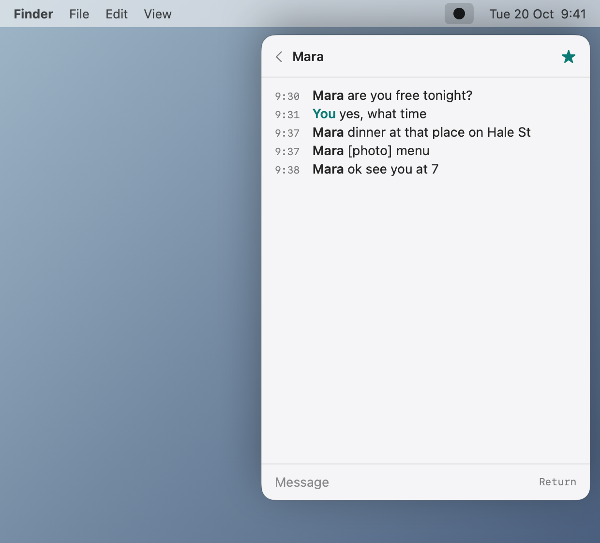

<p align="center"></p>

<h1 align="center">Hush</h1>

Telegram as plain text in your Mac menu bar. A list of chats, one conversation, one box to type in. No avatars, stickers, media, search, replies or forwards. Agents get the same text through MCP.

<p align="center"></p>

## Install with an AI agent

Paste this into an AI coding agent such as Claude Code. Hush checks and installs its own prerequisites on first launch, so the agent does not have to:

```text
Install Hush on this Mac.
1. Run: curl -fsSL https://raw.githubusercontent.com/kalahroudi/hush/main/scripts/install.sh | bash
2. Hush opens and its setup checks what it needs. Tell me to click "Set everything up" if it is waiting.
   It also asks for a free Telegram API ID and hash from https://my.telegram.org/apps. I will enter them
   myself in the Hush window. Do not ask me to paste them into this chat.
3. Tell me to sign in with my phone number in the Hush popover (menu bar dot), then wait until it shows my chats.
4. Register its MCP server: claude mcp add hush --scope user -- /Applications/Hush.app/Contents/MacOS/hush-mcp
5. Call hush_status and tell me what it reports.
Only send a message with hush_send after I tell you what to say. Every send also needs my approval in a dialog.
```

## Install yourself

```sh
curl -fsSL https://raw.githubusercontent.com/kalahroudi/hush/main/scripts/install.sh | bash
```

Or download the DMG from [Releases](https://github.com/kalahroudi/hush/releases) and drag Hush to Applications.

### If macOS says it can't verify Hush

Hush is not notarized by Apple yet, so a DMG downloaded in a browser is blocked the first time. The install script above avoids this. For the DMG:

1. Open Hush once and dismiss the warning (do not choose Move to Bin).
2. Open **System Settings, Privacy & Security** and scroll to **Security**.
3. Click **Open Anyway** next to "Hush was blocked", then confirm with your password or Touch ID.

You only do this once. Or run `xattr -dr com.apple.quarantine /Applications/Hush.app` in Terminal. Releases are signed and notarized automatically once a Developer ID certificate is added to the repo's secrets, and then this step disappears.

Open Hush. The first-run setup has two steps:

1. **TDLib.** Telegram's official client library. Click **Set everything up** and Hush downloads its own current copy (about 11 MB, checksum verified) into `~/Library/Application Support/Hush/lib`. No Homebrew and no admin rights. An old TDLib from Homebrew is ignored, because Telegram refuses to sign in with it.
2. **Telegram API key.** Telegram asks every client app for a free API ID and hash. Open [my.telegram.org/apps](https://my.telegram.org/apps), sign in, create an app (any name), and paste both values into the setup form. They identify the app, not your account, and are stored in a private file on your Mac.

Then sign in with your phone number and the code Telegram sends you.

## How it works

- **The dot.** The menu bar icon is filled when you have unread messages in unmuted chats, outlined when you are caught up, and dashed while offline. There are no badges or sounds.
- **Chats.** Click the icon for your chats, newest first.
- **Conversation.** Messages read like a log: time, name, text. Photos, voice notes and files appear as a marker such as `[photo]`. Nothing is downloaded.
- **Typing.** Type and press Return. That is the whole input.
- **Keyboard.** Up and Down move the highlight in the chat list, Return opens the highlighted chat. Tab and Shift+Tab open the next or previous chat, even while typing in the message box, and wrap around at the ends. In the popover, Tab opens the first chat and Shift+Tab the last. The same list is in Settings under Shortcuts.
- **Favorites stack.** Press Control+Option+S (the default) from any app to see unread messages from your favorite chats as a stack of cards, newest on top. Down and Right go to the next card, Up and Left to the previous one, Esc closes it. Press the shortcut again to close it too.
- **Banners for favorites.** Star a chat inside its conversation and it shows a banner for new messages. Everything else stays silent. Muted chats never notify.

<p align="center"></p>

## For agents (MCP)

Hush ships a stdio MCP server inside the app. If Hush is not running, the server starts it quietly in the background.

| Tool | What it does | Changes anything |
|---|---|---|
| `hush_status` | Signed-in account and unread count | no |
| `hush_list_chats` | Chats with id, title, unread, last line | no |
| `hush_read` | Latest plain-text messages of one chat. Does not mark them read | no |
| `hush_send` | Sends a message as you | **asks you every time** |

Every `hush_send` opens a native dialog with the chat and the full text. It sends only if you press Send, and it denies on timeout. There is no setting that skips it. Settings has a switch to stop agents reading your chats at all, and Settings, Agents connects Claude Code, Claude Desktop, Cursor, Windsurf, Gemini CLI and Codex CLI in one click.

For other clients:

```sh
claude mcp add hush --scope user -- /Applications/Hush.app/Contents/MacOS/hush-mcp
```

An agent skill that explains when and how to use the tools is in [`skills/hush`](skills/hush/SKILL.md).

## Light by design

- No polling. Telegram pushes updates, and nothing runs for the interface while the popover is closed.
- The popover and settings window are destroyed when closed. The footer of the popover shows the app's own memory footprint.
- No message or file database. History is fetched when you open a chat and dropped when you leave it.
- No third-party Swift packages. TDLib is loaded at runtime from its own private copy.

## Privacy and security

- Your Telegram session lives in TDLib's local database under `~/Library/Application Support/Hush`, encrypted with a random key kept in your Keychain.
- Hush talks to Telegram only, through TDLib. It sends nothing anywhere else. Update checks go to GitHub, at most once a day.
- The agent bridge is a Unix socket readable only by your user account.
- Removing Hush completely: delete `Hush.app` and `~/Library/Application Support/Hush`.

## Updates

Hush checks GitHub Releases at most once a day and updates in place, keeping the previous version until the new one has started successfully. Settings, Updates also offers the main branch, built from source.

## Build from source

Needs the Xcode command line tools. To run the app, first open it once and let setup download TDLib, or build the library yourself with `scripts/build-tdlib.sh` (needs `brew install cmake gperf openssl@3`).

```sh
swift build && swift test
scripts/bundle.sh            # builds dist/Hush.app
dist/Hush.app/Contents/MacOS/Hush --snapshot docs/assets   # regenerate the screenshots
```

Layout: `Sources/HushKit` is the UI-free core (TDLib client, chat model, agent bridge), `Sources/Hush` the app, `Sources/hush-mcp` the MCP server.

## License

Apache-2.0. See [LICENSE](LICENSE). TDLib is licensed separately under the Boost Software License.
